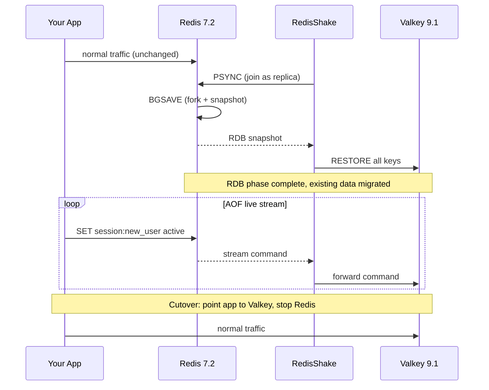

# Valkey Migration Demo

Live migration from Redis 7.2 to Valkey 9.1 using [RedisShake](https://github.com/tair-opensource/RedisShake).

RedisShake copies existing data (RDB snapshot) and then keeps streaming live writes (AOF) until you cut over. Your source keeps serving traffic the whole time.

```
Redis 7.2  ──► RedisShake ──► Valkey 9.1
(source)                      (target)
```

---

## How it works

RedisShake runs in four phases:

**Phase 1: Handshake**
RedisShake connects to source Redis and identifies itself as a replica using the PSync protocol. Redis thinks it is talking to another Redis node joining as a replica.

**Phase 2: RDB snapshot (bulk copy)**
Redis forks itself and writes a full snapshot of everything in memory. RedisShake receives that snapshot and writes every key to Valkey using `RESTORE` commands. Your source keeps serving traffic normally during this, the fork is copy-on-write, so Redis does not pause.

**Phase 3: AOF live stream (continuous sync)**
Once the snapshot is done, Redis keeps the replication connection open and streams every new write command in real time; the same mechanism it uses for its own replicas. RedisShake receives each command and forwards it to Valkey. This is the `syncing aof, diff=[0]` phase. It runs indefinitely until you stop it.

**Phase 4: Cutover**
You stop RedisShake, point your application at Valkey, and stop Redis.



### Workload breakdown

| Component | What it does |
|---|---|
| Source Redis | Forks once for BGSAVE, then streams replication commands continuously |
| RedisShake | Reads from source, optionally filters, writes to target, all in memory |
| Target Valkey | Receives RESTORE commands during RDB phase, then live commands |
| Your app | Nothing changes, keeps talking to Redis until you cut over |

The heaviest moment is the RDB phase: Redis forks, which temporarily doubles memory usage on the source. After that, the AOF stream is lightweight, near-zero latency command forwarding.

---

## Prerequisites

- [Docker](https://docs.docker.com/get-docker/) and Docker Compose
- `redis-cli` for writing test data to the source (ships with Redis or install via your package manager)

---

## Step 1: Start the environment

```bash
docker compose up -d
```

This starts:
- `source`: Redis 7.2 on `localhost:6379`
- `target`: Valkey 9.1 on `localhost:6380`

Verify both are up:

```bash
docker compose ps
```

---

## Step 2: Seed data into source Redis

```bash
./seed.sh
```

This loads 9 keys into the source Redis instance across four real-world data patterns:

| Pattern | Keys |
|---|---|
| Session store | `session:user:1042`, `session:user:2891`, `session:user:4417` |
| Shopping carts | `cart:8821`, `cart:9034` |
| Rate limit counters | `rate_limit:api:203`, `rate_limit:api:891` |
| Feature flags | `feature:dark_mode`, `feature:beta_checkout` |

Confirm what landed:

```bash
docker exec source redis-cli DBSIZE
# 9
```

At this point the target is empty:

```bash
docker exec target valkey-cli DBSIZE
# 0
```

---

## Step 3: Download RedisShake

Check your architecture:

```bash
uname -m
# x86_64  → use linux-amd64
# aarch64 → use linux-arm64
```

Download the latest release and extract it into the project directory:

```bash
# For x86_64
wget https://github.com/tair-opensource/RedisShake/releases/download/v4.6.2/redis-shake-v4.6.2-linux-amd64.tar.gz
tar -xzf redis-shake-v4.6.2-linux-amd64.tar.gz
cp redis-shake-v4.6.2-linux-amd64/redis-shake .
chmod +x redis-shake
```

```bash
# For aarch64
wget https://github.com/tair-opensource/RedisShake/releases/download/v4.6.2/redis-shake-v4.6.2-linux-arm64.tar.gz
tar -xzf redis-shake-v4.6.2-linux-arm64.tar.gz
cp redis-shake-v4.6.2-linux-arm64/redis-shake .
chmod +x redis-shake
```

Check the [releases page](https://github.com/tair-opensource/RedisShake/releases) if a newer version is available.

---

## Step 4: Review the migration config

```bash
cat shake.toml
```

```toml
[sync_reader]
cluster = false
address = "127.0.0.1:6379"

[redis_writer]
cluster = false
address = "127.0.0.1:6380"
```

`cluster = false` means standalone mode on both sides. `sync_reader` uses the PSync protocol: it first copies the full RDB snapshot, then stays alive streaming AOF commands. No downtime on the source.

---

## Step 5: Run RedisShake

Make sure the target is empty before starting. If you have run this demo before, flush Valkey first:

```bash
docker exec target valkey-cli FLUSHALL
```

Then start the migration:

```bash
./redis-shake shake.toml
```

Watch the log output. You will see two phases:

1. **RDB phase**: RedisShake connects and copies all existing keys to the target.
2. **AOF phase** : RedisShake stays alive and forwards every new write from source to target in real time. Look for this line to confirm you are in the live phase:
   ```
   INF syncing aof, diff=[0]
   ```
   `diff=[0]` means source and target are fully in sync.

The process does not exit, this is intentional. Leave it running and open a second terminal.

---

## Step 6: Verify existing data migrated

```bash
./verify.sh
```

You should see the same keys and values on both source and target:

```
=== Source (Redis 7.2 :6379) ===
Keys: 7

-- Sessions --
{"uid":4417,"role":"editor","expires":3600}

-- Carts --
item:101
2
item:203
1
item:445
5

=== Target (Valkey 9.1 :6380) ===
Keys: 7

-- Sessions --
{"uid":4417,"role":"editor","expires":3600}

-- Carts --
item:101
2
item:203
1
item:445
5
```

> Note: keys with short TTLs (rate limit counters, short-lived sessions) may have expired by the time you run this, that is expected and both sides will still match.

---

## Step 7: Write to source while RedisShake is running

With RedisShake still running in the other terminal, write a new key to the source:

```bash
redis-cli -p 6379 SET session:new_user active
```

Now read it from the target:

```bash
docker exec target valkey-cli GET session:new_user
# active
```

The write went to Redis 7.2. RedisShake forwarded it to Valkey 9.1. The target is live.

---

## Step 8: Stop RedisShake and cut over

When you are satisfied the target is in sync, stop RedisShake (`Ctrl+C`), point your application at `localhost:6380`, and stop the source:

```bash
docker compose stop source
```

---

## What RedisShake does NOT do

- **No checkpoint or resume.** If RedisShake is interrupted during the RDB phase, restart from the beginning.
- **No cluster topology changes.** Do not add or remove shards while RedisShake is running.
- **One-time migration, not continuous sync.** This is the right tool for a cutover, not an ongoing replication setup.

---

## Tear down

```bash
docker compose down
```
